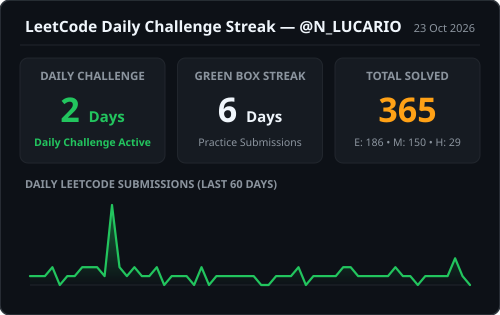
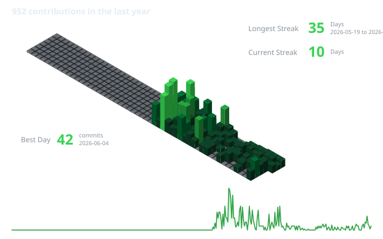

### Hi 👋, I'm Nitin Bhandari

I am an **Electronics & Communication Engineering (ECE)** undergraduate at the **National Institute of Technology (NIT), Raipur**. I enjoy solving algorithmic problems in **C++**, building front-end web interfaces, and taking ideas from concept to execution through hackathons and campus committees.

- 🌱 **I’m currently learning:** **JavaScript** and **Data Structures & Algorithms (DSA)** in **C++**, alongside **Python (Basics)**.
- ⚡ **Daily Practice:** Solving the Daily Coding Challenge and algorithmic problems on [LeetCode (@N_LUCARIO)](https://leetcode.com/u/N_LUCARIO/).
- 🏛️ **Campus Executive Roles @ NIT Raipur:** **Event Management Executive** (*Think India* & *Shaurya Sports Committee*) and **Innovation Development Executive** (*Innovation Cell*).
- 💬 **Ask me about:** C++, Data Structures & Algorithms, HTML5, CSS3, JavaScript, and Campus Event & Innovation Management.
- 📫 **How to reach me:** [LinkedIn](https://www.linkedin.com/in/nitin-bhandari/) • [Email](mailto:YOUR_EMAIL@gmail.com)

### 🌐 Socials:

  
  
  

---

### Skills

<table width="100%">
  <thead>
    <tr>
      <th width="50%" align="left">I have</th>
      <th width="50%" align="left">I'm learning</th>
    </tr>
  </thead>
  <tbody>
    <tr>
      <td valign="top">
        

          
        

        <b>Core Stack:</b> C++, HTML5, CSS3
      </td>
      <td valign="top">
        

          
        

        <b>Currently Learning:</b> JavaScript, Data Structures & Algorithms (DSA), and Python (Basics)
      </td>
    </tr>
  </tbody>
</table>

### IDE/GUI's I like

  

---

### 💻 Completed Project

* **Bikri Bot** — An AI-powered assistant built for local retailers to simplify customer query handling, product lookups, and everyday shop workflows through a clean web interface.

---

### 🏛️ Experience, Leadership & Achievements

| Role / Title | Organization / Event | Key Details |
| :--- | :--- | :--- |
| **Event Management Executive** | **Think India, NIT Raipur** | Leading event operations, on-ground logistics, and creative prop execution for campus-wide initiatives. |
| **Event Management Executive** | **Shaurya Sports Committee, NIT Raipur** | Managing sports fest event execution, team coordination, and campus-wide athletic tournament logistics. |
| **Innovation Development Executive** | **Innovation Cell, NIT Raipur** | Driving student innovation programs, ideation workshops, and technical committee initiatives. |
| **🥈 2nd Place Winner** | **Vibe Coding — Aavartan (NIT Raipur)** | Secured 2nd place in the competitive coding and rapid-prototyping challenge at NIT Raipur's tech fest. |
| **Hackathon Participant** | **ISRO Bharatiya Antariksh Hackathon** | Formulated the **DRISHI** low-light planetary surface image enhancement concept with *Team Orbitally Inclined*. |
| **Student Volunteer** | **National Service Scheme (NSS), NIT Raipur** | Contributed to community service camps and rural digital literacy outreach programs. |

**Certifications & Challenges:** *Programming in Python* • *Introduction to Back-End Development* • *Foundations of Cybersecurity* • *BrandStorm National Marketing Challenge*

---

### 📊 Coding Activity & Live Streaks

<table width="100%">
  <tr>
    <td width="46%" valign="middle" align="center">
      
        
      
    </td>
    <td width="54%" valign="middle" align="center">
      
    </td>
  </tr>
</table>
